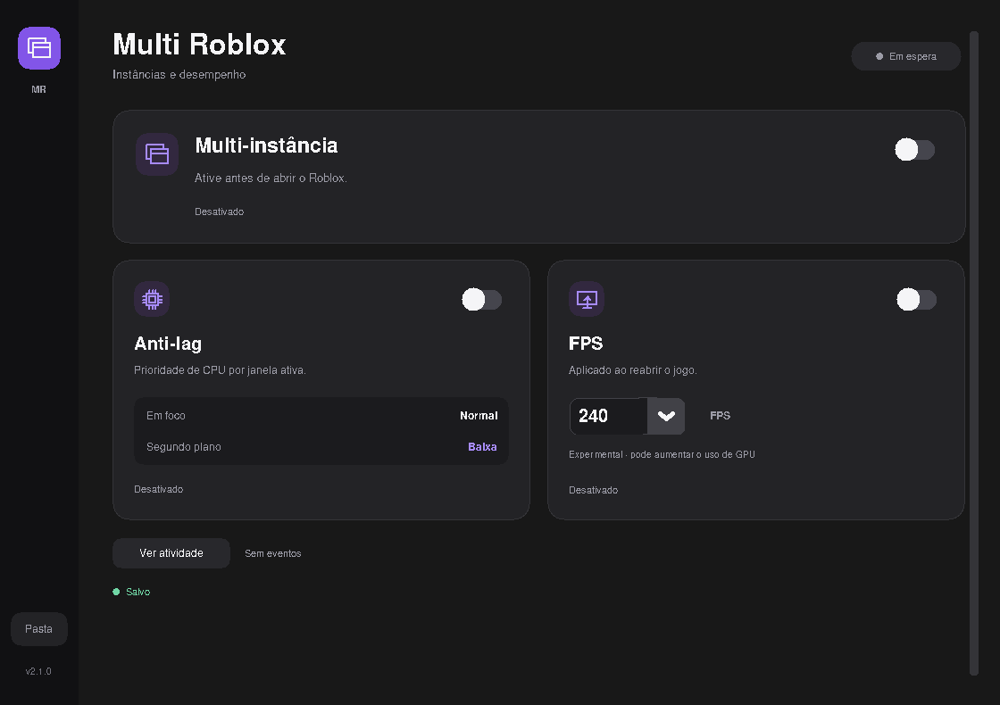

# Multi Roblox · Desktop

Aplicativo Windows com interface escura em **CustomTkinter**, multi-instância,
prioridade de CPU por janela ativa e ajuste reversível do limite de FPS.
A versão 2.1 usa cards de desempenho lado a lado e histórico recolhível.
Código aberto sob licença MIT. O modo de console original continua disponível.



Captura da GUI em display de teste; a tipografia pode variar no Windows.

## Instalar e abrir

Requisitos: Windows 10/11, cliente desktop do Roblox e Python 3.10–3.13.
Recomendado: [Python 3.13 de 64 bits](https://www.python.org/downloads/windows/)
com o launcher `py` e o suporte Tcl/Tk padrão do instalador.

No PowerShell, use uma pasta do seu usuário, evitando `C:\Windows\System32`:

```powershell
cd $env:USERPROFILE
git clone https://github.com/RexJohnson679/multiplas-contas-roblox.git
cd multiplas-contas-roblox
py -3 -m venv .venv
.\.venv\Scripts\python.exe -m pip install -r requirements.txt
.\.venv\Scripts\python.exe desktop_app.py
```

Se já clonou, entre na pasta e execute `git pull --ff-only` antes de instalar as
novas dependências. Os comandos usam diretamente o Python da `.venv`; não é
necessário ativar scripts do PowerShell ou alterar sua política de execução.

## Controles

### Multi-instância

1. Feche os clientes Roblox e a ferramenta antiga de console.
2. Abra a GUI e ative **Multi-instância**. Aguarde a indicação **Ativo**.
3. Abra uma experiência usando a primeira conta pelo site oficial.
4. Para outra conta, use outro perfil de navegador, outro navegador ou uma sessão
   anônima independente. Abas comuns compartilham cookies; janelas anônimas do
   mesmo navegador também podem compartilhar uma sessão.
5. Mantenha o aplicativo aberto. Ao terminar, feche os clientes e depois a GUI.

A GUI conserva a combinação usada pelo comando anterior com `--legacy-mutex`:

- Evento `ROBLOX_SINGLE_INSTANCE`, de reset manual, inicialmente não sinalizado.
- Mutex `ROBLOX_singletonMutex`, com propriedade mantida pela thread de trabalho.

Um evento não tem proprietário; manter seu handle não o torna um mutex nem impede
outro processo autorizado de sinalizá-lo. A referência consultada do ic3w0lf22 usa
`ROBLOX_singletonMutex`. O comportamento do cliente pode mudar com atualizações;
a existência desses objetos não comprova compatibilidade com qualquer versão.

Criação, propriedade e liberação do mutex ocorrem na **mesma thread**, por exigência
da API do Windows. `Event.wait()` mantém a thread sem espera ocupada. A janela usa
uma fila de mensagens e `after()`; workers nunca alteram widgets diretamente.
Objetos preexistentes são recusados e erros de permissão são mostrados em Atividade.
As ACLs padrão do usuário são mantidas, sem solicitar elevação automaticamente.

### Otimizador de desempenho / Anti-Lag

Ao ativar, o aplicativo consulta `GetForegroundWindow` e
`GetWindowThreadProcessId` a cada **750 ms**. Para processos cujo nome é exatamente
`RobloxPlayerBeta.exe`, sem diferenciar maiúsculas/minúsculas:

| Situação | Prioridade de CPU |
| --- | --- |
| A janela em foco pertence ao cliente | Normal (`NORMAL_PRIORITY_CLASS`) |
| Cliente minimizado ou atrás de outra janela | Baixa (`IDLE_PRIORITY_CLASS`) |
| Nenhum cliente está em foco | Todos os clientes ficam em Baixa |

`psutil` aplica a classe de prioridade usando as APIs do Windows. Não há injeção,
suspensão de threads, encerramento de clientes, alteração de afinidade ou prioridade
Real Time/Alta. Novos processos são detectados, e processos encerrados são tolerados.
A identidade considera PID e instante de criação para evitar restaurar um PID
reutilizado por outro processo.

Ao desativar ou fechar a GUI normalmente, as prioridades originais dos processos
que ainda existem são restauradas. Falhas de acesso são informadas; não se tenta
contornar permissões do sistema. Fechamento forçado pode impedir a restauração:
nesse caso, encerre e reabra normalmente os clientes afetados.

**O ganho depende da carga de CPU.** Baixar a prioridade não limita diretamente
FPS, GPU, RAM, rede ou temperatura e não elimina todos os tipos de lag. Clientes
em segundo plano podem ficar menos responsivos, principalmente com CPU ocupada.

### Desbloquear FPS — experimental

Escolha **60, 120, 144, 165, 240 ou 360** antes de ativar. A opção escreve apenas a
chave `DFIntTaskSchedulerTargetFps` em:

```text
%LOCALAPPDATA%\Roblox\Versions\version-*\ClientSettings\ClientAppSettings.json
```

Só são consideradas pastas que contêm `RobloxPlayerBeta.exe`. As demais opções
JSON são preservadas. Reinicie os clientes depois de aplicar; escrever a chave
não altera o FPS de um cliente já aberto. Enquanto ativada, a opção verifica a
instalação a cada cinco segundos para reconhecer novas versões.

Um diário `fps-backup.json`, salvo **antes** da edição, registra o valor original
da chave em cada instalação. Ao desligar ou fechar normalmente, o valor original
é restaurado, preservando outras opções. Arquivos criados pelo aplicativo só são
removidos se ficarem vazios. Alterações posteriores feitas por outro programa na
mesma chave prevalecem. Um diário pendente é recuperado na próxima abertura.
Não apague esse diário enquanto houver restaurações pendentes.

Clientes atuais podem ignorar FastFlags locais ou restringi-los por allowlist.
O aplicativo mostra a configuração solicitada; não mede nem promete o FPS real.
Prefira o controle de FPS oficial do jogo quando disponível. Um limite alto pode
**aumentar o uso de GPU e piorar o desempenho com duas contas**, portanto teste
valores moderados. O cliente da Microsoft Store não é alvo desta configuração.

## Preferências e logs

Os arquivos ficam fora da instalação, em uma pasta gravável pelo usuário:

```text
%LOCALAPPDATA%\MultiplasContasRoblox\
    config.json       # opções da interface e limite de FPS
    fps-backup.json   # valor original da chave de FPS por instalação
    app.log           # diagnóstico local, com rotação
```

O botão **Pasta** na sidebar abre essa pasta. As opções são salvas a cada
mudança e reativadas na próxima abertura. Fechar a janela restaura os efeitos sem
apagar suas preferências. Um `config.json` inválido é preservado com nome
`config.invalid-*.json` antes de carregar os padrões. Gravações são atômicas.
Uma única GUI por sessão do Windows evita edições concorrentes do diário.

## Gerar seu próprio `.exe`

O procedimento completo, incluindo pacote portátil, arquivo único, hashes,
assinatura e falsos positivos, está em **[Compilação no Windows](docs/build-windows.md)**.
Exemplo usando a `.venv` criada acima:

```powershell
.\.venv\Scripts\python.exe -m pip install -r requirements-build.txt
.\.venv\Scripts\python.exe -m unittest discover -s tests -v
.\.venv\Scripts\python.exe -m PyInstaller --noconfirm --clean MultiplasContasRoblox.spec
```

Resultado: **`dist\MultiplasContasRoblox.exe`**, um único arquivo sem console.
O `.spec` já define o equivalente a **`--onefile --noconsole`**, com `console=False`,
e incorpora fontes, temas e bibliotecas. Não exige variável de ambiente.

**Abra esse `.exe` com dois cliques no Explorador de Arquivos.** Apenas a interface
gráfica aparece, e o programa funciona sem PowerShell aberto. Para começar agora:

```powershell
Start-Process .\dist\MultiplasContasRoblox.exe
```

Depois de compilado, não é necessário instalar Python para executar esse arquivo.
O modo de fonte `python desktop_app.py` continua ligado ao terminal que o iniciou;
use o executável para o funcionamento independente do console.

O workflow [Build Windows](.github/workflows/build-windows.yml) também compila no
GitHub Actions, verifica o subsistema gráfico e testa a abertura do executável e disponibiliza um artefato para baixar
em **Actions → Build Windows → execução concluída → Artifacts**. Isso depende de o
workflow terminar com sucesso; nenhum binário é incluído no código-fonte.

## Console original e desenvolvimento

O modo antigo continua sem dependências externas:

```powershell
py -3 multi_roblox.py --legacy-mutex
```

Não use a GUI e o console simultaneamente para segurar os mesmos objetos.
Para rodar os testes da aplicação desktop, primeiro instale `requirements.txt`:

```powershell
.\.venv\Scripts\python.exe -m unittest discover -s tests -v
.\.venv\Scripts\python.exe desktop_app.py --smoke-test
```

O smoke test abre e fecha uma GUI com preferências temporárias, sem iniciar os
recursos ou tocar a instalação do Roblox. Os testes cobrem prioridades, erros de
acesso, PID reutilizado, persistência, restauração parcial de FPS e workers.
Os testes nativos do Windows usam objetos com nomes aleatórios; não o jogo real.
No Linux, são ignorados explicitamente. Testes de GUI exigem um display.

| Arquivo | Responsabilidade |
| --- | --- |
| `desktop_app.py` | Entrada da GUI e smoke test isolado |
| `multi_roblox.py` | API de eventos/mutex e console original |
| `roblox_tools/gui.py` | Interface escura e coordenação dos recursos |
| `roblox_tools/workers.py` | Threads cooperativas e trava da GUI |
| `roblox_tools/optimizer.py` | Foco, prioridades e restauração |
| `roblox_tools/fps.py` | Edição reversível do JSON do cliente |
| `roblox_tools/settings.py` | Preferências e escrita atômica |

## Transparência e limitações

O aplicativo não lê cookies, senhas ou tokens, não faz requisições de rede nem
injeta código. Ele enumera nomes de processos e altera suas prioridades; a opção
de FPS modifica explicitamente o JSON local documentado acima. Esses efeitos são
ativados pelos controles da interface. Logs são locais e não são enviados.

Ausência de injeção não garante ausência de detecção, banimentos, restrições ou
sanções. Respeite os termos vigentes da Roblox e as regras de cada experiência.
Não há afiliação com a Roblox Corporation. Software sem garantias, sob a
[licença MIT](LICENSE). O desempenho e a compatibilidade com cada versão do jogo
precisam ser verificados no Windows com os clientes reais.

## Referências

- [ic3w0lf22: ROBLOX_singletonMutex](https://github.com/ic3w0lf22/Roblox-Account-Manager/blob/c2b13d146d5db609d499870145e8d2dff2506581/RBX%20Alt%20Manager/AccountManager.cs#L1254-L1273).
- [CreateEventW](https://learn.microsoft.com/en-us/windows/win32/api/synchapi/nf-synchapi-createeventw) e [CreateMutexW](https://learn.microsoft.com/en-us/windows/win32/api/synchapi/nf-synchapi-createmutexw).
- [SetPriorityClass](https://learn.microsoft.com/en-us/windows/win32/api/processthreadsapi/nf-processthreadsapi-setpriorityclass).
- [CustomTkinter](https://github.com/TomSchimansky/CustomTkinter), [psutil](https://github.com/giampaolo/psutil) e [PyInstaller](https://github.com/pyinstaller/pyinstaller).
